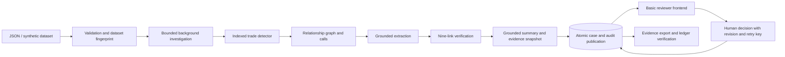

# DealerWatch architecture

DealerWatch keeps financial evidence processing deterministic and assigns final decisions to a human reviewer. A model can add grounded extraction cues and propose prose; it cannot change the recommendation rules or perform an escalation.

## Responsibilities

| Area | Files | Responsibility |
|---|---|---|
| HTTP boundary | `api.py`, `security.py` | Routes, roles, sessions, body/origin guards, errors |
| Application orchestration | `services.py`, `jobs.py` | Active dataset, cached validation, one bounded worker, durable run history |
| Data boundary | `datasets.py`, `io.py`, `data/` | Validation, content-addressed imports, reference resolution, seeded scenarios |
| Detection | `detect/sandwich.py`, `detect/links.py` | Windowed trade indexing, profit/scoring and relationship graph |
| Evidence processing | `agent/` | Call gathering, grounded cues, nine-link recommendation, checked narrative |
| Durable publication | `pipeline.py`, `evidence_snapshot.py`, `store.py`, `persistence.py` | Immutable snapshots, version identities, atomic publication and decision transactions |
| Reusable adapters | `toolkit/` | LLM/provider fallback and cache, ASR, grounding, ledger hashes |
| Presentation/export | `web/`, `exports.py` | Basic same-origin interface and portable evidence/CSV exports |
| Evaluation | `eval/harness.py` | Isolated labelled evaluation against the trade-only baseline |

## Run lifecycle

`POST /api/runs` reserves a single worker and immediately returns a job. Its durable states are QUEUED, RUNNING, SUCCEEDED or FAILED. Stages report loading, detection, investigation and publication progress. Imports, evaluations and destructive demo operations share the execution gate. They fail with 409 when an incompatible operation is active. Ordinary health/case reads and human decisions remain available during analysis.

A run loads and fingerprints evidence, archives available audio by SHA-256, builds symbol/time indexes once, and caches repeated transcriptions/extractions. Analysis produces cases and audit events in memory. Only after all analysis succeeds does one attached SQLite transaction publish cases, statistics and ledger events. A failure before/during publication cannot partially replace previously published investigations. Abandoned background jobs are marked failed at startup and can be resubmitted; they are not silently replayed.

The worker uses one process and one thread. Progress/job metadata lives in `jobs.db`; cases in `dealerwatch.db`; chained audit events in `ledger.db`. The last two use on-disk rollback journals and FULL synchronization, permitting atomic attached-file commits. The system rejects unsupported WAL/in-memory audited writes. Provider calls and audio copying happen outside the database transaction.

## Evidence and versions

Cases have a content-derived identity incorporating dataset scope, loaded evidence (including audio), candidate/trade details, link path, material cues and the verified recommendation. A narration-only wording change does not create a new version. A materially changed investigation creates a separate case, leaving prior human decisions intact. Exact reruns retain the original case and append `case.reused` audit events.

Each case stores its raw trade rows, the actual transcribed utterances used, relevant reference clauses, bounded price bars and node labels. Audio is copied to `runtime/evidence/audio/<sha256>.wav`; the API serves those archived bytes when a case is specified. Later data imports or overwritten source recordings cannot rewrite old case evidence. Legacy cases without a snapshot are explicitly marked `evidence_available=false` and are never joined to newly imported data.

The queue and overview include retained case versions. Profit is an estimate across those versions, not an additive claim about distinct misconduct or recoverable funds. Evidence JSON exports contain the exact case's audit events and an independently recomputable document digest. The digest proves file consistency, not external authenticity.

## Human review and security

Each successful human decision validates terminal state and optional revision inside the write transaction, then saves the updated case and appends its audit event together. Idempotency keys preserve the original response to an identical retry; reusing a key for a different request fails. Concurrent finalizations cannot both succeed. `CLOSED` and `ESCALATED` are terminal.

No tokens means local administrator mode. Configured distinct admin/reviewer tokens enable authentication for all evidence/API/audio reads. Browser sessions are opaque, HttpOnly, SameSite=Strict cookies with an eight-hour lifetime; tokens remain in server environment. In authenticated mode the server binds reviewer attribution to the configured identity. Admin controls datasets, investigations and destructive demo operations. Reviewer controls ordinary case decisions. This small role system is not an enterprise identity provider or a multi-user directory.

Foreign-origin writes and evaluation triggers are rejected. Upload bodies are bounded before JSON parsing, including chunked requests. Dataset validation rejects missing collections, duplicate/unsafe identifiers, dangling references, inconsistent timestamps/utterances/OHLC values, unsafe audio paths, and non-finite/unreasonable numeric values. Dynamic UI content uses DOM text nodes. Sessions and login rate limits are process-local, consistent with the single-worker deployment.

## Evaluation and limits

Evaluation uses a dedicated, marked runtime and refuses an existing live application/review database. Each evaluation replaces its own previous population. UI links resolve only an exact evaluated case version that exists in the live store; an unpublished analysis has no misleading historical link.

The synthetic generator intentionally suppresses accidental background sandwiches and plants known scenarios. Perfect results on this universe show scenario correctness and an explainable difference from the baseline; they do not measure field precision. All market timestamps use naive ISO-8601 **IST**. Profit uses matched quantities and volume-weighted prices, omitting fees, taxes and execution slippage.

The ledger detects edits, sequence gaps and broken links against its stored chain. Without an independently anchored head, full disk access can replace/truncate the whole history. External anchoring, live feed adapters, enterprise identity, multi-tenancy, retention policies and a distributed queue are deployment work outside this verified rehearsal.
